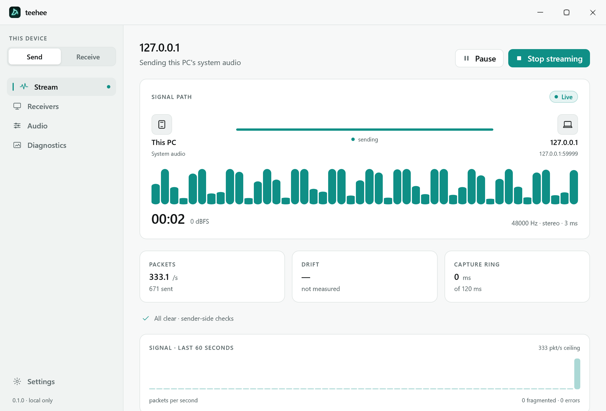
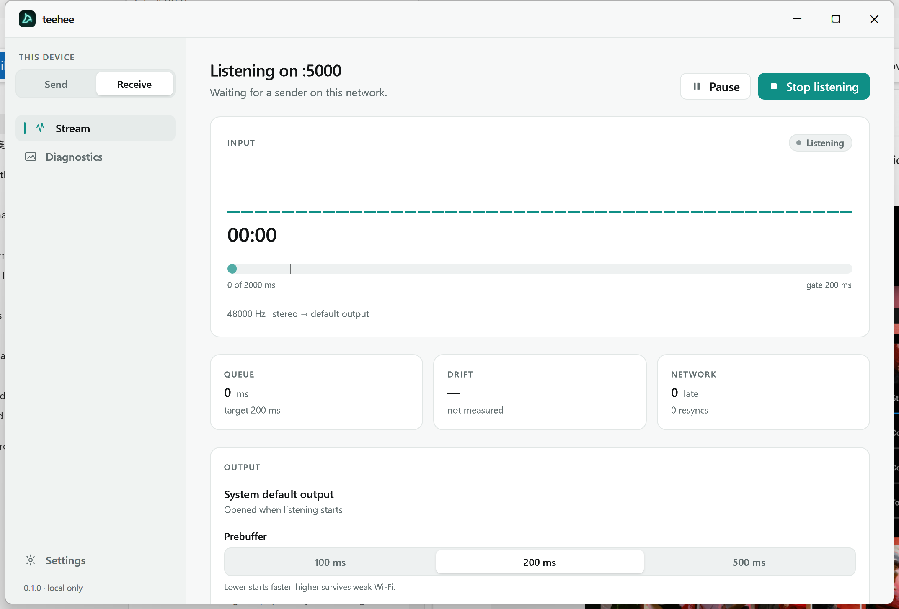
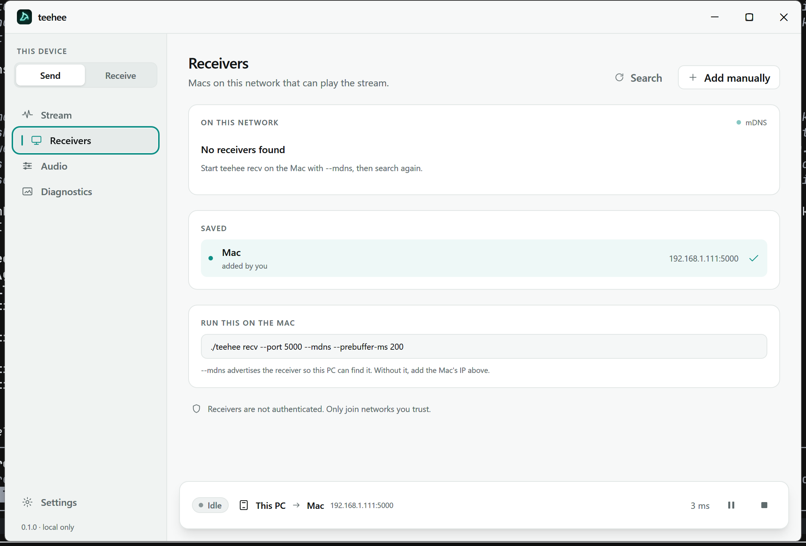
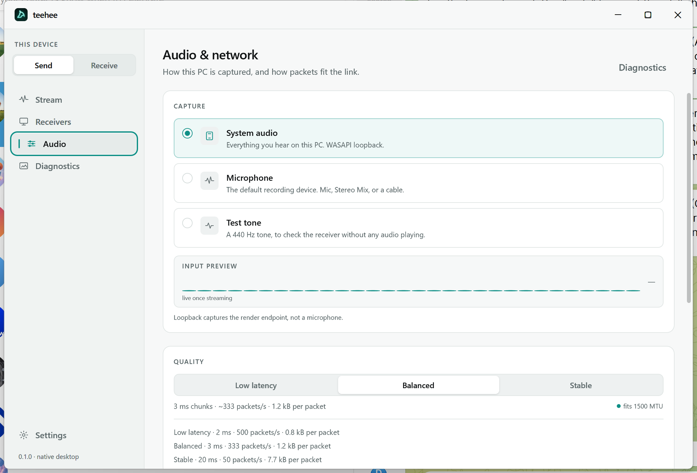
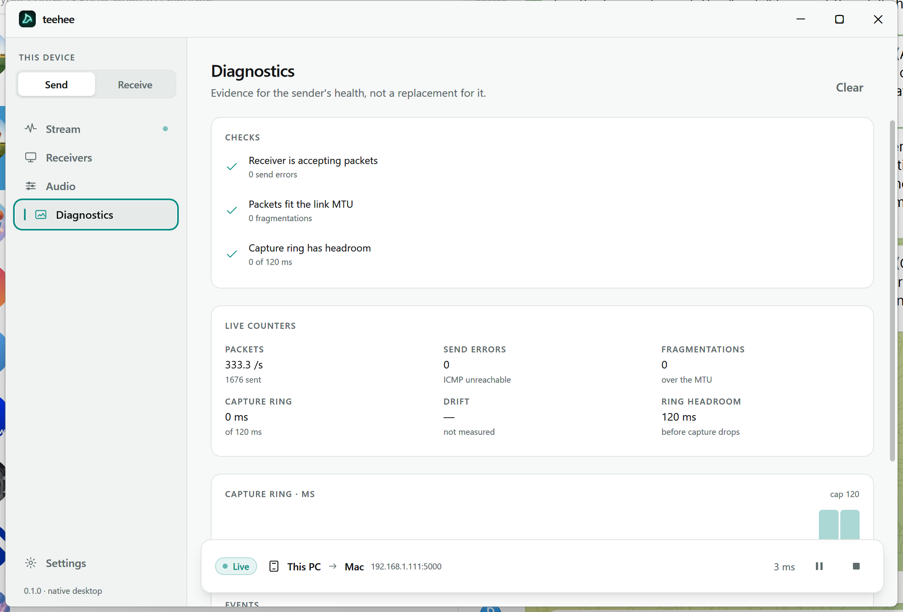
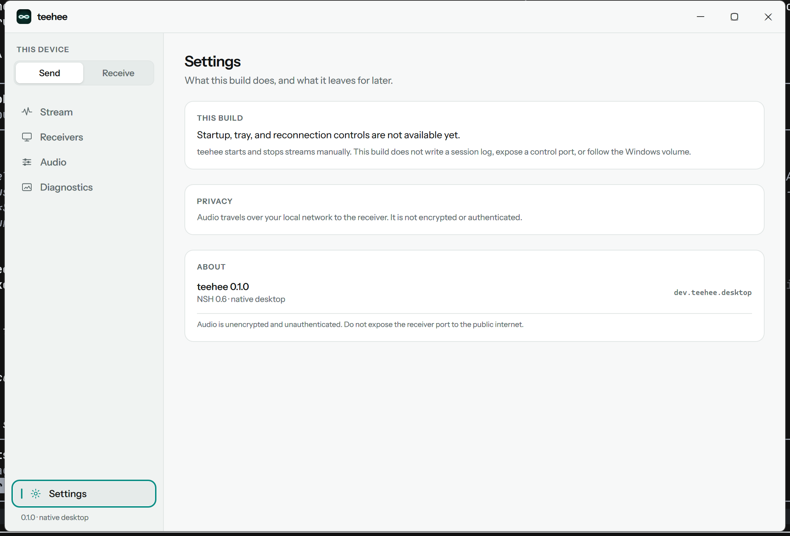

# teehee

Stream Windows system audio to a Mac (or any LAN peer) over UDP — no AirPlay,
no Python audio stack, no codec, no installer, no runtime dependencies.



teehee is one small Rust binary for the sender and the receiver, plus a native
desktop app prototype. The sender captures whatever Windows is playing through
WASAPI loopback; the receiver plays it through the default output device on the
other side of the LAN.

## Why

AirPlay locks you to Apple devices, and the usual open-source alternatives need
a Python audio stack or a daemon. teehee is a single self-contained binary with
a 25-byte header and raw f32 PCM payload: no codec, no compression, no pairing,
no cloud. It works on any LAN where UDP can get through, and it is designed for
the unglamorous part of the problem — staying healthy for hours in the
background on a Windows machine.

## What you get

- **One-way audio bridge.** Windows system audio (or a test tone) to a Mac,
  Linux box, or another Windows machine.
- **Low-latency jitter buffer** with a prebuffer gate, sequence reordering,
  underrun resync, and clock-drift compensation on both ends.
- **mDNS discovery** so the sender can find a receiver by name instead of IP.
- **Operable headless:** JSONL stats logging, local TCP control commands,
  optional follow-system-volume, and Task Scheduler recipes with watchdogs and
  log rotation.
- **Desktop GUI prototype** with a stream view, receiver list, audio settings,
  diagnostics, and a persistent stream bar (see [GUI](#desktop-gui-preview)).

## Quick start

Build the CLI (Rust 1.98+):

```bash
cargo build --release
```

On the receiving machine (Mac / Linux / Windows):

```bash
./teehee recv --port 5000 --prebuffer-ms 200 --rx-buffer-ms 2000 --stats
```

On the Windows sender, streaming system audio:

```powershell
.\teehee.exe send --host <mac-ip> --port 5000 `
  --capture-source=loopback --chunk-ms 20 --stats
```

Need a tone instead of real audio? Add `--sine` and run both ends on one
machine. To discover a receiver advertising with `--mdns`, replace `--host`
with `--mdns` on the sender.

That is the entire setup. For every flag, the wire format, and the tuning
recipes, see the [detailed reference](docs/reference.md).

## Desktop GUI (preview)

A native desktop app built with [NSH](https://nsh.dev/) lives in [`gui/`](gui/).
It wraps the same concepts in a calmer interface: a quiet sidebar, a floating
stream bar, plain-language health checks, and explicit source choices (system
audio / microphone / test tone) — no silent `auto` mode.

> **Status:** the UI currently runs on a mock session (`gui/src/state/session.ts`)
> that simulates a sender and receiver so the screens and state transitions can
> be developed without hardware. It is a design prototype, not yet a controller
> for the CLI engine. See the [GUI README](gui/README.md) and the
> [design specification](docs/gui-design.md).

<table>
  <tr>
    <td align="center" width="50%">
      <br>
      <b>Stream — live sender</b>
    </td>
    <td align="center" width="50%">
      <br>
      <b>Stream — receiving</b>
    </td>
  </tr>
  <tr>
    <td align="center" width="50%">
      <br>
      <b>Receivers — mDNS + saved</b>
    </td>
    <td align="center" width="50%">
      <br>
      <b>Audio — source &amp; quality</b>
    </td>
  </tr>
  <tr>
    <td align="center" width="50%">
      <br>
      <b>Diagnostics</b>
    </td>
    <td align="center" width="50%">
      <br>
      <b>Settings</b>
    </td>
  </tr>
</table>

To run it from source (requires the `nsh` CLI):

```bash
cd gui
nsh run App.tsx
```

Each GitHub release also carries native GUI bundles built by CI: a macOS
`.app` (arm64 and Intel), a Linux `.tar.gz`, and a portable Windows `.zip`.
They carry the same mock session as the source build, so treat them as
previews of the interface rather than a replacement for the CLI.

## How it works

Every packet is a 25-byte little-endian header followed by interleaved f32
PCM samples: magic `TEHE`, version, sequence, frame timestamp, sample rate,
channels, format tag, and payload length. Each packet stands on its own, so a
receiver can join mid-stream and recover from startup loss using only the
sequence number.

The sender captures PCM from WASAPI loopback (or a default input device, or a
synthetic sine), chunks it, and paces packets against the capture ring. The
receiver reorders by sequence, fills a jitter buffer up to the `--prebuffer-ms`
gate, then plays out through cpal. Both sides track fill drift and nudge their
pacing/resampling to keep the buffer stable instead of letting delay creep up
over a six-hour session.

Nothing is encrypted or authenticated. The TLA specifications for the jitter
ring, prebuffer anchor, and sender pacing are in [`specs/`](specs/README.md).

## CLI at a glance

| | |
|---|---|
| `teehee devices` | List audio endpoints visible to cpal. |
| `teehee recv --port 5000` | Listen and play. `--stats` for console telemetry, `--log-file` for JSONL. |
| `teehee send --host <ip>` | Stream the default input device. |
| `teehee send --capture-source=loopback` | Stream Windows system audio. |
| `teehee send --mdns` | Find a `--mdns` receiver on the LAN automatically. |
| `teehee send --sine` | 440 Hz test tone; no hardware needed. |

Common tuning: `--chunk-ms` (packet interval), `--capture-buffer-ms` (sender
ring), `--prebuffer-ms` (receiver gate), `--rx-buffer-ms` (receiver ring depth),
`--mtu` (link envelope). The hard rule is
`--rx-buffer-ms >= --prebuffer-ms`.

See the [detailed reference](docs/reference.md) for the complete flag list,
JSONL field names, low-latency recipe, clock-drift math, and troubleshooting.

## Operating it on Windows

For an always-on sender, run `teehee.exe` directly from a Task Scheduler task:
the at-logon trigger puts it in the interactive session where WASAPI loopback
actually captures audio, and a repeating trigger plus a named single-instance
mutex provide self-healing without a supervisor. `scripts/send_watch.ps1` reads
the JSONL stats and alerts on drift, ring fill, or a dead sender; a watchdog
watches the watcher. All of it is installed with `just install-watch`,
`just install-watchdog`, and `just install-rotate`.

Full XML, thresholds, and verification commands are in the
[detailed reference](docs/reference.md#windows-deployment-scheduled-task).

## Security

teehee sends unencrypted, unauthenticated UDP. Anyone who can reach the
receiver's port can inject audio or listen to the stream. Use it only on a
trusted LAN, and never expose the receiver port to the public internet.

## Development

```bash
cargo build --release   # CLI binary
cargo test              # full Rust suite
cargo clippy --all-targets -- -D warnings
cd gui && nsh run App.tsx   # GUI prototype
```

`just` recipes wrap the common commands (`just ci`, `just build`, `just test`,
`just lint`, `just sender`).

## Docs

- [Detailed reference](docs/reference.md) — flags, protocol, deployment, tuning, troubleshooting
- [GUI design specification](docs/gui-design.md) — the app's design thesis and screens
- [GUI README](gui/README.md) — how the prototype is structured
- [TLA+ specifications](specs/README.md) — jitter ring, prebuffer, sender pacing

## License

MIT — see [LICENSE](LICENSE).
